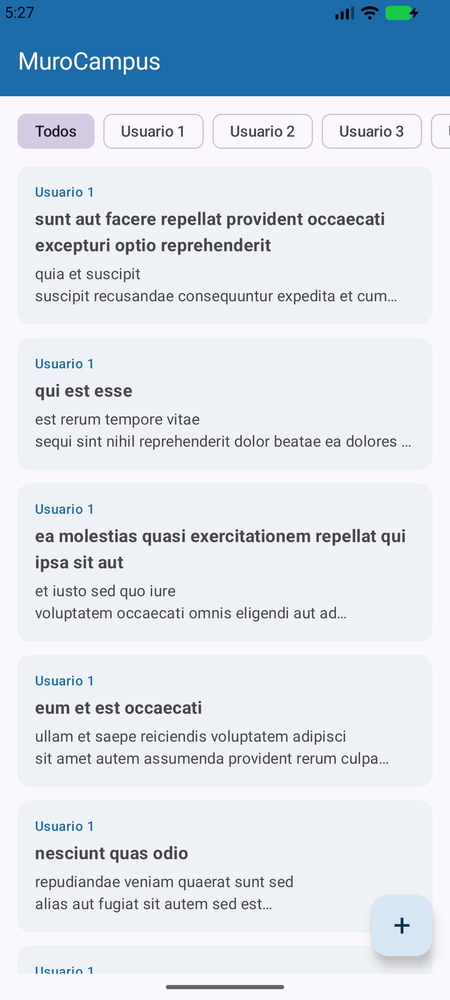
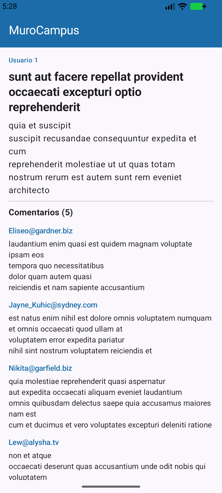
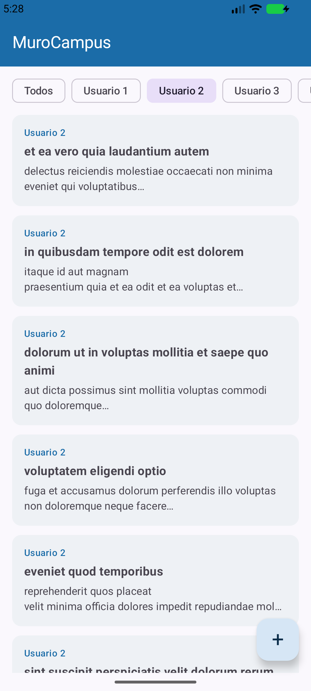
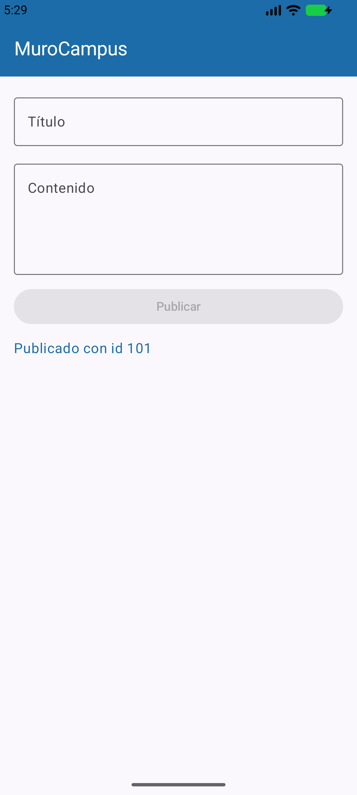
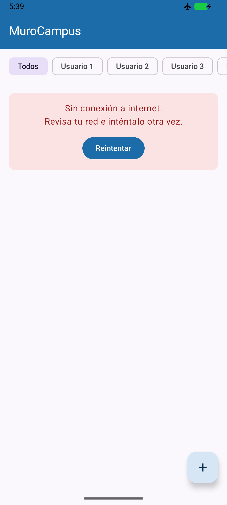

# MuroCampus — Servicios Web y REST (Semana 09)

**Alumno:** Angel Rosales · **Curso:** Programación en Móviles · **Docente:** Juan León S.

App en Kotlin + Jetpack Compose que consume la API REST de
[JSONPlaceholder](https://jsonplaceholder.typicode.com/): lista publicaciones, muestra el
detalle con sus comentarios, filtra por usuario y crea una publicación. Si la red falla,
muestra el error y permite reintentar.

## Árbol de paquetes

```
com.tecsup.murocampus/
├── MainActivity.kt
├── model/
│   └── Modelos.kt                 Post, Comentario, NuevoPost, Usuario
├── data/
│   ├── remote/
│   │   ├── PostApi.kt             interface de Retrofit
│   │   └── RetrofitClient.kt      OkHttp + conversor JSON
│   ├── PostRepository.kt          interface + PostRepositoryRemote (devuelve Result)
│   └── MensajeDeError.kt          mensajeDe(Throwable)
├── viewmodel/
│   ├── UiState.kt                 Cargando / Exito / Error
│   ├── PostsViewModel.kt
│   └── PostsViewModelFactory.kt
└── ui/
    ├── Componentes.kt             TarjetaPost, Cargando, ErrorConReintento
    ├── PantallaLista.kt
    ├── PantallaDetalle.kt
    ├── PantallaCrear.kt
    └── theme/
```

`mensajeDe` está en `data/` y no en `viewmodel/UiState.kt`, para cumplir la regla de que
el paquete `viewmodel/` no conozca `HttpException`.

## Arquitectura MVVM + Repository

```
View (PantallaLista, PantallaDetalle, PantallaCrear)
   |  eventos: cargar, filtrar, abrir, publicar    ^  collectAsStateWithLifecycle()
   v                                               |
ViewModel (PostsViewModel) --- StateFlow<UiState> (Cargando / Exito / Error) --->
   |  viewModelScope.launch
   v
PostRepository (interface)  <- devuelve Result<...>
   -> PostRepositoryRemote (captura las excepciones)
   |
   v
PostApi (Retrofit) --- OkHttp ---> https://jsonplaceholder.typicode.com/
```

## Capturas

| Lista | Detalle | Filtro |
|---|---|---|
|  |  |  |

| Crear | Error de conexión |
|---|---|
|  |  |

## Para pensar

**1. ¿Qué diferencia hay entre GET y POST? ¿Por qué crear lleva `@Body` y porUsuario lleva `@Query`?**
GET pide datos sin modificarlos; POST envía datos para crear un recurso. `crear` manda un
objeto completo, que viaja como JSON en el cuerpo (`@Body`). `porUsuario` solo acota una
lectura, así que el dato va en la URL: `posts?userId=2` (`@Query`).

**2. ¿Por qué la ruta es `"posts"` y no `"/posts"`?**
Con `/` inicial, Retrofit la toma como ruta absoluta desde el host y descarta cualquier
camino de la URL base. Aquí la base no tiene camino y funcionaría igual, pero con una base
como `https://servidor.com/api/v1/` se perdería `api/v1/`.

**3. ¿Por qué el Repository devuelve `Result` en vez de dejar que la excepción llegue al ViewModel?**
Porque el fallo de red es un resultado esperable. Con `Result`, el ViewModel atiende éxito
y fallo sin conocer Retrofit ni sus excepciones, y ninguna excepción olvidada cierra la app.
La única que se relanza es `CancellationException`, que las corrutinas necesitan.

**4. ¿Qué pasa si olvidas el permiso INTERNET? ¿Y si olvidas `ignoreUnknownKeys` y el servidor agrega un campo?**
Sin el permiso la app compila, pero Android bloquea la conexión y toda llamada falla aunque
haya internet. Sin `ignoreUnknownKeys`, un campo nuevo lanza `SerializationException` y la
app muestra *Respuesta inesperada*.

**5. ¿Por qué la pantalla de lista usa un `when` sobre `UiState` y no un `if` con tres variables?**
Con tres variables se puede llegar a combinaciones imposibles (cargando y con error a la
vez). `UiState` es una *sealed interface*: solo hay un estado a la vez y el compilador
obliga a que el `when` cubra todos.

**6. JSONPlaceholder no guarda los POST. ¿Cómo cambiaría tu app si usaras un servicio real?**
Tras publicar habría que recargar la lista (o agregarle el post devuelto), porque el nuevo sí
existiría. También haría falta iniciar sesión y enviar un token, tomar el `userId` del usuario
real y evitar que un reintento cree duplicados.
