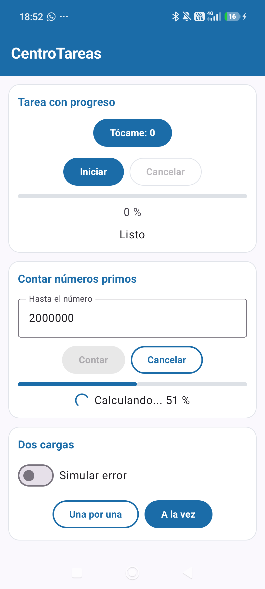
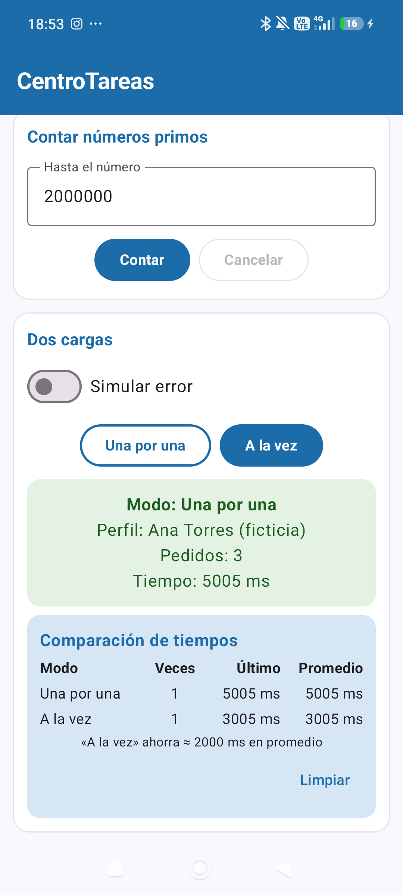

# PROMPTS.md — Fase 2 (rama `mejora-ia-sem14`)

Asistente usado: **Claude Code** (en lugar de Gemini en Android Studio).
Regla aplicada: *la IA propone, yo decido*. Todo lo generado se leyó, se compiló y se
probó en el celular antes de cada commit; se verificó que no aparezcan `GlobalScope`,
`runBlocking` ni `Thread.sleep` y que siempre se relance la `CancellationException`.

| Prompt que escribí | Qué respondió la IA | Qué cambié o descarté | Por qué |
|---|---|---|---|
| «Mueve la tarea simulada con progreso al Repository y expón el avance como un Flow con `flowOn(Dispatchers.Default)`, sin romper MVVM.» | Agregar `progresoTarea(): Flow<Float>` a la interface, implementarlo con `flow { delay(40); emit(i / 100f) }.flowOn(Dispatchers.Default)` y en el ViewModel reemplazar el `for` por `repo.progresoTarea().collect { ... }`. | Lo acepté. Moví el `Log.d("HILO", "Dentro: ...")` al Repository y mantuve `Antes`/`Despues` en el ViewModel. Conservé el `try/finally` de `corriendo` y el `Job` para cancelar. | `flowOn` cambia solo el hilo del productor; el `collect` sigue en `main`, así que actualizar el estado es seguro. Logcat confirmó: *Antes: main → Dentro: DefaultDispatcher-worker-1 → Despues: main*. |
| «Muestra el porcentaje del cálculo de primos mientras avanza.» | Dos opciones: convertir `contarPrimos` en un `Flow` que emita progreso y resultado, o pasarle un callback `alAvanzar: (Float) -> Unit`. | Elegí el **callback** con valor por defecto `{}` y avisando solo cada 1 % (`n % (hasta / 100)`). Descarté emitir en cada número. | Mantiene la firma `suspend` y el `ensureActive()` del Paso 5; avisar millones de veces saturaría el StateFlow. `MutableStateFlow` es seguro entre hilos, así que puede actualizarse desde `Default`. |
| «Agrega una tabla que acumule los tiempos de Una por una y A la vez para ver la diferencia.» | Un `data class TiemposCarga` en `model/`, un `StateFlow<TiemposCarga>` en el ViewModel actualizado con `update { }` al terminar cada carga, y una tabla en Compose con veces, último y promedio. | Lo acepté y agregué la fila del ahorro promedio y un botón **Limpiar**. La tabla solo aparece cuando hay datos. | `update { }` evita perder escrituras; la View solo muestra el estado. Prueba en el celular: Una por una 5005 ms, A la vez 3005 ms, ahorro ≈ 2000 ms. |
| «¿Agrego también `withTimeout` de 2 s a las cargas?» | Envolver las cargas con `withTimeout(2000)` y capturar `TimeoutCancellationException` para mostrar «Tardó demasiado». | **Descartado.** | Los pedidos tardan 3 s por diseño, así que *todas* las cargas fallarían siempre y se perdería la comparación del Paso 6. Además `TimeoutCancellationException` hereda de `CancellationException` y habría que tratarla aparte del `throw e`. |

## Mejoras implementadas

| # | Mejora | Capas que cambian | Commit |
|---|---|---|---|
| 1 | Progreso desde el Repository como `Flow` | Repository + ViewModel | Se trasladó la tarea simulada al Repository y se expuso su progreso como Flow con flowOn |
| 2 | Primos con progreso | Repository + ViewModel + View | Se añadió el porcentaje de avance al conteo de números primos |
| 3 | Comparación de tiempos | Model + ViewModel + View | Se implementó la tabla de comparación de tiempos entre Una por una y A la vez |

| Primos con progreso | Comparación de tiempos |
|---|---|
|  |  |
