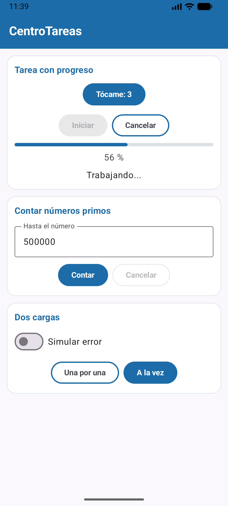
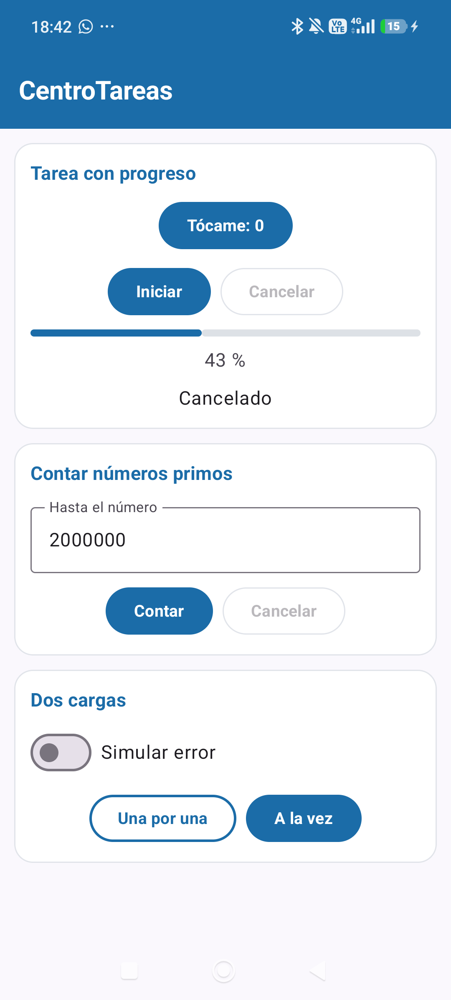
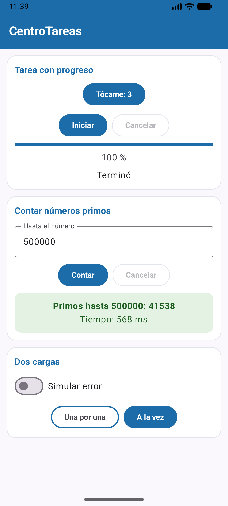
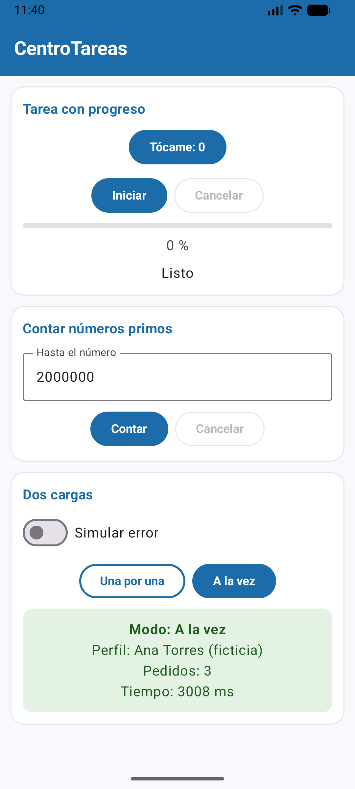
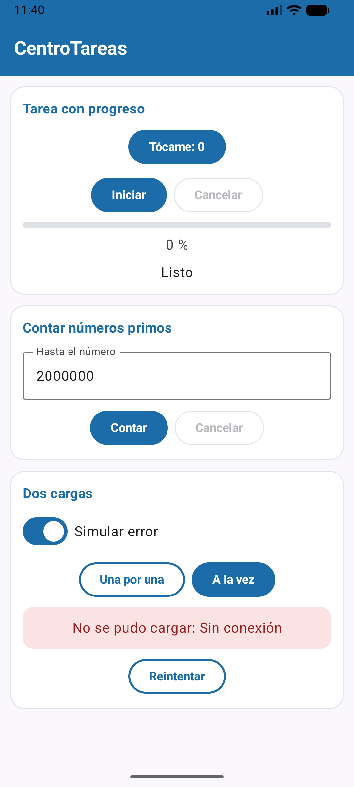

# CentroTareas — Hilos en Android (Semana 14)

**Alumno:** Angel Rosales · **Curso:** Programación en Móviles · **Docente:** Juan León S.

App en Kotlin + Jetpack Compose + Material 3 que ejecuta tres trabajos que tardan
(una tarea con barra de progreso, contar números primos y dos cargas simuladas)
**sin bloquear nunca el hilo principal**, usando corrutinas, `viewModelScope`,
`withContext`, `Job`, `async` y manejo de errores. Todos los datos son ficticios.

## Árbol de paquetes

```
com.tecsup.centrotareas/
├── MainActivity.kt
├── model/
│   └── Estados.kt               PrimosUi, CargaUi
├── data/
│   ├── TareasRepository.kt      interface
│   └── TareasRepositoryLocal.kt cargas simuladas + contarPrimos
├── viewmodel/
│   ├── TareasViewModel.kt       lógica de segundo plano (pasos 1 a 7)
│   └── TareasViewModelFactory.kt
└── ui/
    ├── PantallaTareas.kt        tres tarjetas
    └── theme/
```

## Arquitectura MVVM + Repository

```
View (PantallaTareas)
   | eventos: botones               ^ collectAsState()
   v                                |
ViewModel (TareasViewModel) --- StateFlow --->
   | viewModelScope.launch { ... }
   v
TareasRepository (interface) ---> TareasRepositoryLocal
                                    (cargas simuladas y contar primos)
```

## Observación del Paso 1

Al pulsar **Tarea larga (MAL)** la pantalla se congela durante 4 segundos: el botón
**Tócame** no responde y los toques no suman. El texto *Trabajando...* nunca se ve
porque `Thread.sleep(4000)` bloquea el hilo principal, que es el mismo que dibuja la
pantalla; el estado cambia a *Trabajando...* pero Compose no tiene oportunidad de
recomponer hasta que el hilo se libera, y para entonces el mensaje ya es *Terminó*.
Si la espera fuera de 10 segundos, Android mostraría el diálogo **ANR**
(*"La aplicación no responde"*), ofreciendo cerrar la app o esperar.

## Logcat (filtro `HILO`)

```
D HILO : Antes: main
D HILO : Dentro: DefaultDispatcher-worker-1
D HILO : Despues: main
```

## Capturas

| Tarea con progreso | Cancelada | Primos |
|---|---|---|
|  |  |  |

| A la vez (≈ 3000 ms) | Una por una (≈ 5000 ms) | Error simulado |
|---|---|---|
|  |  |  |

> El valor por defecto del cálculo de primos es **2 000 000** (148 933 primos), porque
> con 500 000 el cálculo tardaba menos de 1 s y no se notaba que la pantalla sigue viva.

## Pruebas de aceptación

| Prueba | Resultado esperado | OK |
|---|---|---|
| Tarea larga: tocar Tócame mientras trabaja | El contador sigue sumando | ✅ |
| Logcat con filtro HILO | main antes y después; DefaultDispatcher-worker dentro | ✅ |
| Iniciar la tarea con progreso | La barra avanza de 0 a 100 % en ≈ 4 s | ✅ |
| Cancelar a mitad | La barra se detiene, dice Cancelado y se puede iniciar otra vez | ✅ |
| Pulsar Iniciar dos veces seguidas | No se lanzan dos tareas (botón deshabilitado) | ✅ |
| Primos hasta 1000 | Resultado 168 | ⬜ |
| Primos con N grande | La pantalla no se congela y Cancelar funciona | ✅ |
| Una por una | ≈ 5 s y resultado correcto | ✅ |
| A la vez | ≈ 3 s y resultado correcto | ✅ |
| Error simulado + Reintentar | Recuadro rojo; al desactivar y reintentar, éxito | ✅ |
| Rotar la pantalla durante la tarea | La tarea continúa y el progreso no se reinicia | ⬜ |
| Revisar el código | `git grep` no encuentra GlobalScope, runBlocking ni Thread.sleep | ✅ |

## Para pensar

1. **¿Por qué no se veía *Trabajando...* en el Paso 1?**
   Porque `Thread.sleep` bloqueaba el hilo principal, que es el que dibuja. El cambio de
   estado ocurrió, pero la pantalla no pudo redibujarse hasta que terminó la espera, y en
   ese momento el mensaje ya era *Terminó*.

2. **¿Qué diferencia hay entre `Thread.sleep` y `delay`?**
   `Thread.sleep` bloquea el hilo completo: nadie más puede usarlo. `delay` es una función
   `suspend` que *suspende* solo la corrutina y libera el hilo para otros trabajos (por
   ejemplo, dibujar); además respeta la cancelación.

3. **¿Por qué `Dispatchers.Default` para los primos y `Dispatchers.IO` para la red?**
   `Default` tiene tantos hilos como núcleos y está pensado para trabajo de CPU (cálculos).
   `IO` tiene un grupo de hilos mucho mayor, pensado para operaciones que pasan la mayor
   parte del tiempo esperando (red, disco, base de datos).

4. **¿Qué pasaría con la corrutina si el usuario cierra la pantalla? ¿Qué papel cumple `viewModelScope`?**
   `viewModelScope` está atado al ciclo de vida del ViewModel: cuando el ViewModel se
   destruye (el usuario sale de la pantalla), se cancelan automáticamente todas sus
   corrutinas, evitando fugas de memoria y trabajo inútil. En cambio, en una rotación el
   ViewModel sobrevive, por eso la tarea continúa y el progreso no se reinicia.

5. **¿Por qué `async` tarda 3 s y no 5 s? ¿Qué pasa si una de las dos cargas falla?**
   Con `async` las dos cargas corren al mismo tiempo, así que el total es el de la más
   lenta: máximo(2 s, 3 s) ≈ 3 s. Si una falla, `coroutineScope` cancela a la otra y
   propaga la excepción; el `try/catch` la atrapa y muestra el estado de error
   (relanzando siempre la `CancellationException`).
