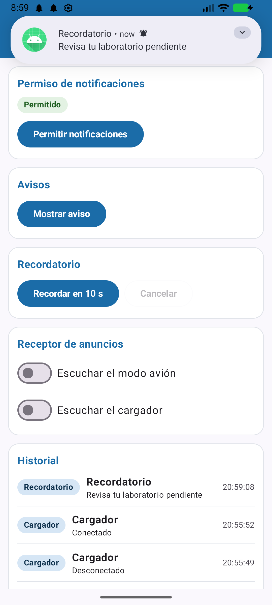
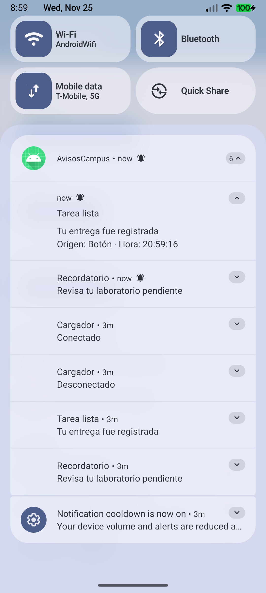
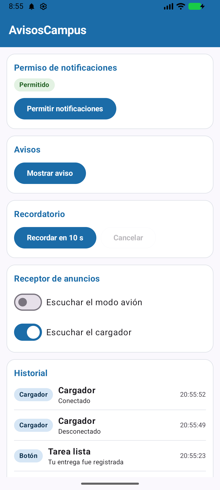

# PROMPTS.md — Fase 2 (rama `mejora-ia-sem15`)

Asistente usado: **Claude Code** (en lugar de Gemini en Android Studio). No hubo un prompt por
mejora: se usó un único pedido general y la IA eligió tres mejoras de la lista de la guía.

| Prompt que escribí | Qué respondió la IA | Qué se cambió o descartó | Por qué |
|---|---|---|---|
| «Desarrolla este laboratorio» (con la guía en PDF) | **Dos canales:** propiedad `urgente` en `Origen`; el `Notificador` elige el canal `Urgentes` (`IMPORTANCE_HIGH`) para el recordatorio. | El ViewModel no cambió: el canal se elige en el `Notificador`. | El canal es un detalle del sistema; el ViewModel sigue sin `NotificationManager`. |
| (mismo pedido) | **Texto largo:** `BigTextStyle` con el texto, el origen y la hora. | Se conservó `setContentText` para la vista plegada. | El texto corto del contrato no debía cambiar. |
| (mismo pedido) | **Receptor del cargador:** `CargadorReceiver`, estado y métodos en el ViewModel, y un switch propio. | Se usó un `DisposableEffect` separado del modo avión. | Cada receptor se registra y se quita en `onDispose` sin afectar al otro. |
| (mismo pedido, Paso 4) | `PendingIntent` inmutable que abre `MainActivity`. | Al probarlo se abría una segunda pantalla con el historial vacío; se agregó `launchMode="singleTop"`. | El ViewModel y el historial deben conservarse al tocar la notificación. |

**Mi criterio (por completar por el alumno):** _…_

## Mejoras implementadas

| # | Mejora | Capas que cambian | Commit |
|---|---|---|---|
| 1 | Dos canales | Model + Notificador | `ia: agrega canal Urgentes para el recordatorio` |
| 2 | Texto largo | Notificador | `ia: muestra el texto completo con BigTextStyle` |
| 3 | Receptor del cargador | Model + Receiver + ViewModel + View | `ia: escucha el cargador con un receptor y switch propios` |

| Canal Urgentes (emergente) | Texto largo | Cargador |
|---|---|---|
|  |  |  |
