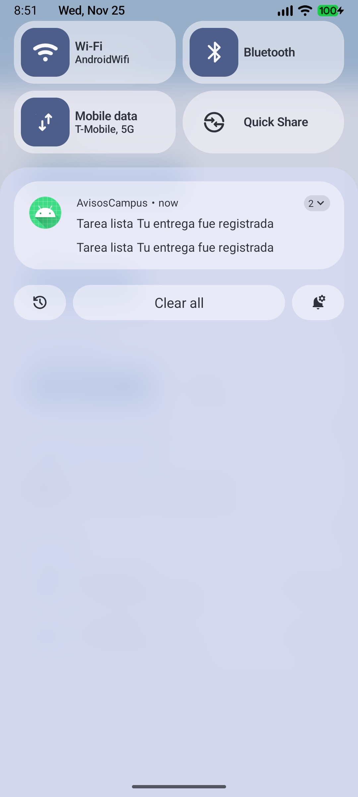
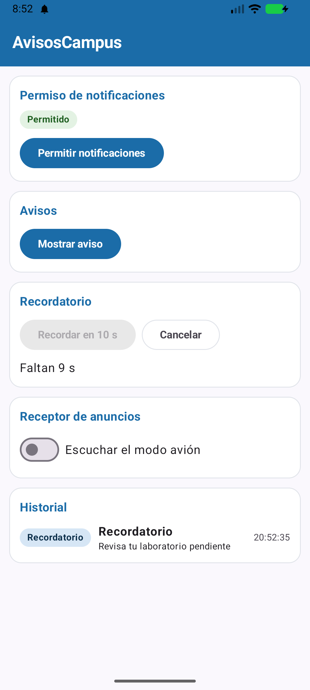
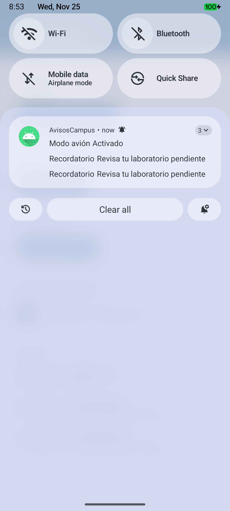
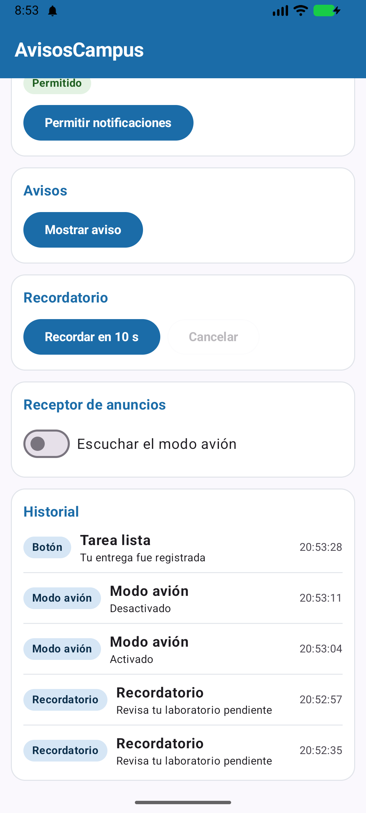
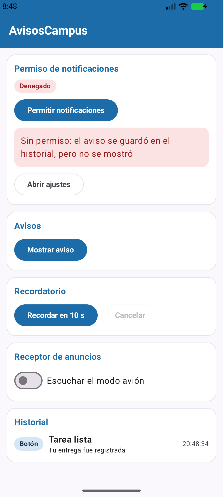

# AvisosCampus — Notificaciones en Android (Semana 15)

**Alumno:** Angel Rosales · **Curso:** Programación en Móviles · **Docente:** Juan León S.

App en Kotlin + Jetpack Compose + Material 3 que muestra notificaciones locales, programa un
recordatorio a los 10 segundos y escucha los cambios del modo avión con un
`BroadcastReceiver`. Todo queda anotado en un historial. Los datos son ficticios.

## Árbol de paquetes

```
com.tecsup.avisoscampus/
├── AvisosApp.kt                   Application: crea el canal
├── MainActivity.kt
├── model/
│   └── Modelos.kt                 Aviso, Origen, PermisoUi
├── data/
│   └── AvisosRepository.kt        interface + AvisosRepositoryMemoria
├── notificacion/
│   └── Notificador.kt             canal, permiso y mostrar
├── receiver/
│   └── ModoAvionReceiver.kt
├── viewmodel/
│   ├── AvisosViewModel.kt
│   └── AvisosViewModelFactory.kt
└── ui/
    ├── PantallaAvisos.kt
    ├── HistorialAvisos.kt
    └── theme/
```

## Arquitectura MVVM + Repository

```
View (PantallaAvisos)
   | eventos: botones, switch          ^ collectAsState()
   v                                   |
ViewModel (AvisosViewModel) --- StateFlow (avisos, permiso, faltan...) --->
   | registra el aviso                 | emite: eventos (SharedFlow<Aviso>)
   v                                   v
AvisosRepository (interface)        La View recibe el evento y llama a
   -> AvisosRepositoryMemoria       Notificador.mostrar(context, aviso)
```

El ViewModel no usa `Context`, `NotificationManager` ni `BroadcastReceiver`.

`MainActivity` usa `launchMode="singleTop"`: sin él, al tocar una notificación con la app
abierta se creaba una segunda pantalla con un ViewModel nuevo y el historial aparecía vacío.

## Capturas

| Notificación en el panel | Recordatorio | Modo avión |
|---|---|---|
|  |  |  |

| Historial | Permiso denegado |
|---|---|
|  |  |

## Pruebas de aceptación

Emulador Medium Phone, API 37.

| Prueba | Resultado esperado | OK |
|---|---|---|
| Ajustes → Apps → AvisosCampus → Notificaciones | Existe el canal Avisos (comprobado con `dumpsys notification`) | ✅ |
| Permitir notificaciones | Aparece el cuadro de Android y la etiqueta cambia | ✅ |
| Mostrar aviso | Aparece la notificación Tarea lista | ✅ |
| Mostrar aviso dos veces | Dos notificaciones distintas | ✅ |
| Tocar la notificación | Se abre la app y la notificación desaparece | ✅ |
| Recordar en 10 s | Cuenta regresiva y aviso al llegar a 0 | ✅ |
| Recordar y minimizar la app | El aviso llega igual | ✅ |
| Recordar y cancelar | No llega ningún aviso | ✅ |
| Switch activado y cambiar el modo avión | Aviso Activado y luego Desactivado | ✅ |
| Switch desactivado y cambiar el modo avión | No hay aviso | ✅ |
| Permiso denegado y Mostrar aviso | Mensaje de error, aviso en el historial y la app no se cierra | ✅ |
| Rotar durante el recordatorio | La cuenta regresiva continúa | ✅ |
| Revisar el código | Sin `Context` en `viewmodel/`; receptores quitados en `onDispose` | ✅ |

## Para pensar

1. **¿Por qué una notificación necesita un canal y un permiso? ¿Qué pasa si falta cada uno?**
   El canal (Android 8+) agrupa avisos del mismo tipo para que el usuario controle su sonido
   e importancia; sin canal, el sistema descarta la notificación. El permiso (Android 13+)
   deja que el usuario decida si la app puede molestarlo; sin él, la notificación no se
   muestra, aunque la app sigue funcionando.

2. **¿Por qué el ViewModel emite un evento y no muestra la notificación él mismo?**
   Para mostrarla hace falta un `Context`. El ViewModel sobrevive a la rotación, así que
   guardar el Context de una Activity filtraría memoria. Emitiendo un evento solo decide
   *qué* avisar y se puede probar sin Android.

3. **¿Qué pasa si usas el mismo id en dos notificaciones?**
   La segunda reemplaza a la primera: en el panel queda una sola.

4. **¿Por qué `onReceive` debe ser corto y por qué hay que quitar el receptor al salir?**
   `onReceive` corre en el hilo principal: un trabajo largo congela la app y puede causar un
   ANR. Si no se quita el receptor, el sistema conserva una referencia a una pantalla que ya
   no existe: se filtra memoria y llegarían avisos duplicados.

5. **¿En qué casos usarías una notificación local y en cuáles una push de Firebase?**
   Local cuando el aviso nace en el mismo celular (recordatorio, temporizador, modo avión) y
   no necesita internet. Push cuando nace en un servidor o en otro usuario (mensaje de chat,
   nota publicada, comunicado del campus).

## Fase 2 (con IA)

Canal Urgentes, texto largo y receptor del cargador (`receiver/CargadorReceiver.kt`).
Detalle y capturas en [PROMPTS.md](PROMPTS.md).
