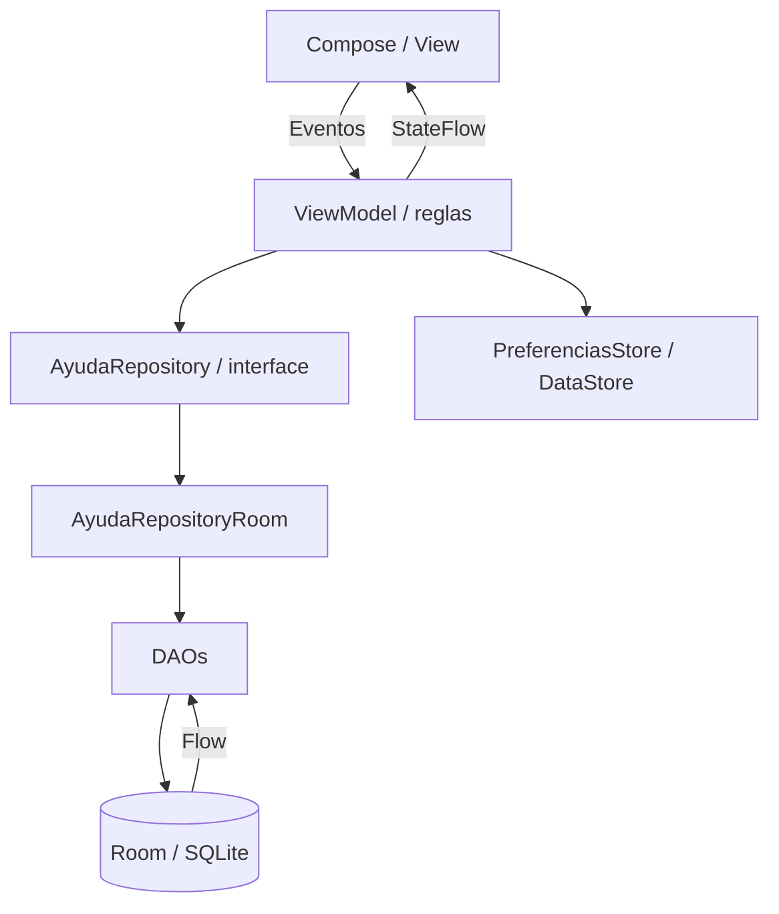
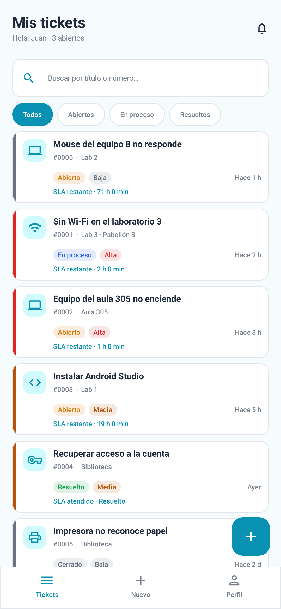
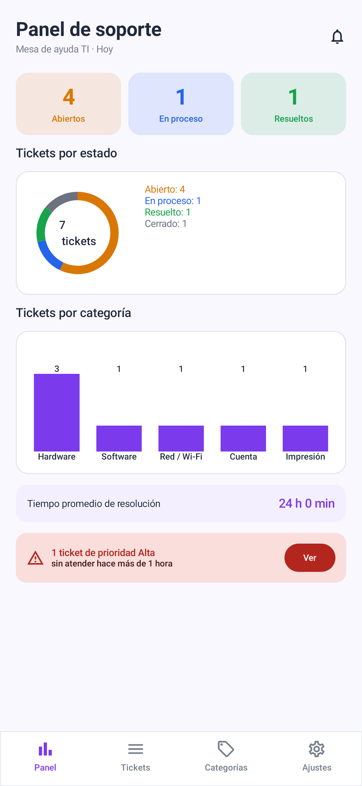
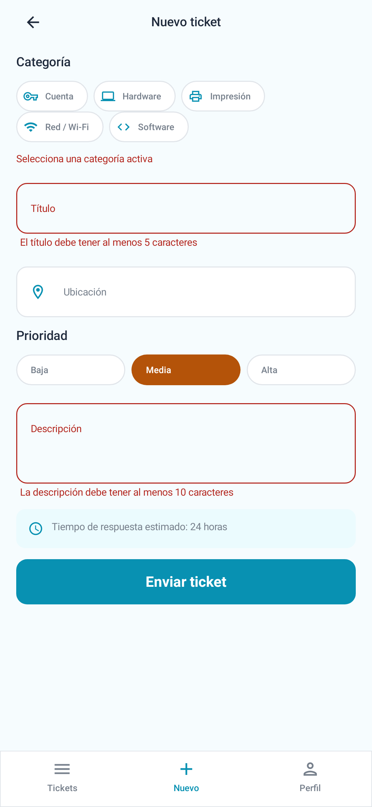
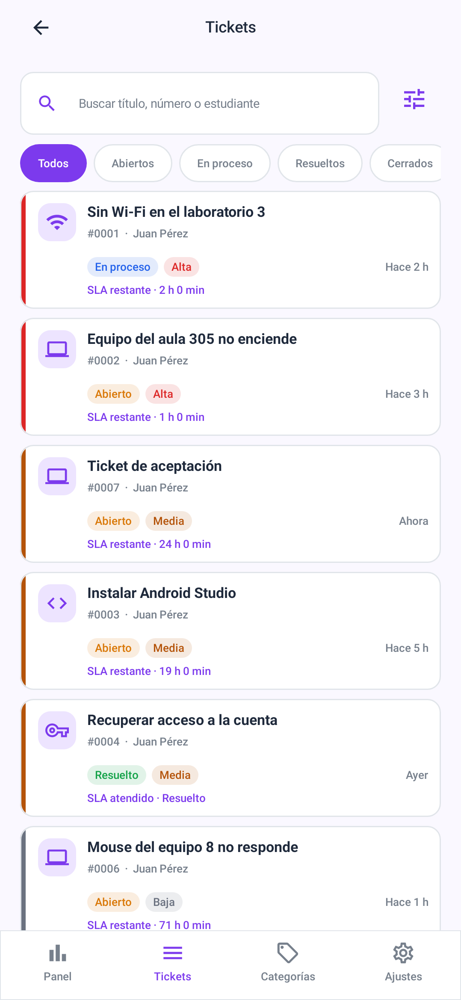
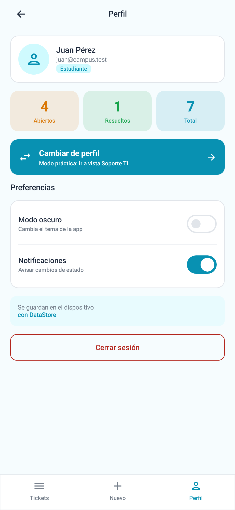
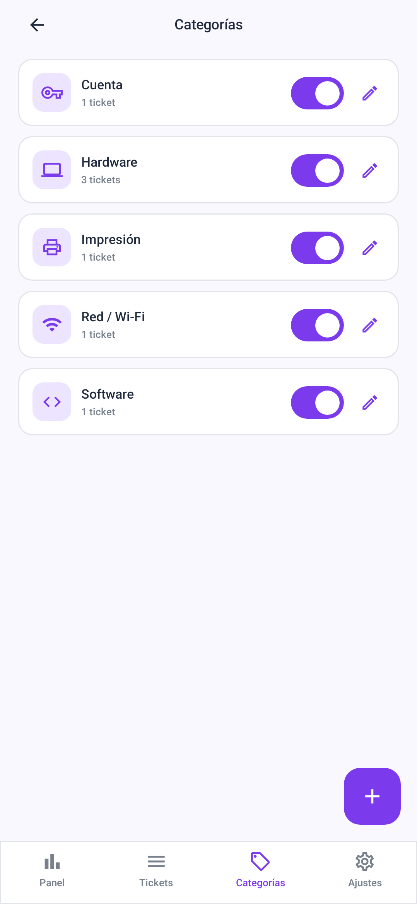

# AyudaCampus · Semana 09

Mesa de ayuda TI local para estudiantes y soporte, desarrollada con Kotlin, Jetpack Compose, Material 3, MVVM, Room 2.6.1 y DataStore.

## Abrir y ejecutar

Abre **Tareas/Semana09** en Android Studio, selecciona **JDK 17** para Gradle, sincroniza y ejecuta `app`. El wrapper usa Gradle 8.9 con AGP 8.7.3 y Kotlin 2.0.21 y KSP 2.0.21-1.0.28. Se requiere Android SDK 36 y un dispositivo Android 7.0/API 24 o superior. `local.properties` contiene la ruta local del SDK y no se publica.

Desde esta carpeta, en Windows:

```powershell
.\gradlew.bat :app:testDebugUnitTest :app:lintDebug
```

Los cambios se abren y ejecutan directamente desde Android Studio.

## Cuentas ficticias iniciales

| Perfil | Correo | Contraseña |
|---|---|---|
| Estudiante · prueba | prueba@prueba.com | 1234 |
| Soporte TI · soporte | soporte@soporte.com | 1234 |
| Estudiante anterior | juan@campus.test | 1234 |
| Soporte TI | soporte@campus.test | admin |

La primera ejecución crea cinco categorías, cuatro usuarios y seis tickets con comentarios. Las cuentas **prueba** y **soporte** se incorporan también en instalaciones existentes, sin borrar usuarios ni historial. La migración 1 → 2 conserva los datos. Cada estudiante ve sus propios tickets; la cuenta prueba comienza sin tickets.

La interfaz sigue las referencias entregadas: acento turquesa para estudiantes y violeta para soporte. Perfil y Ajustes muestran el nombre y correo de la sesión; el registro incluye controles independientes para mostrar u ocultar contraseña y confirmación.

El modo práctica permite cambiar de perfil desde Perfil/Ajustes sin volver al login. Si entras con un estudiante registrado, el cambio de vuelta desde soporte conserva ese estudiante durante la sesión. Cada equipo tiene su propia base; no se conecta a un servidor.

## Funciones

- Login con selector de rol, validación de credenciales, registro de estudiantes con correo único y restauración de sesión.
- Estudiante: solo sus tickets; búsqueda por título/número; filtros por estado; formulario con errores por campo y categorías activas.
- Detalle: conversación ordenada, seguimiento del estado, calificación obligatoria de 1 a 5 para cerrar un resuelto, comentario final opcional y reapertura de resueltos.
- Soporte: bandeja por prioridad ALTA/MEDIA/BAJA y fecha descendente; atención con estado/prioridad/respuesta; CERRADO deshabilitado y tickets cerrados sin edición.
- Panel: conteos reactivos, dona por estado, barras por categoría y alerta de ALTA abiertos con más de una hora; el límite se actualiza cada minuto.
- Categorías: crear, editar, activar/desactivar y eliminar solo si no tienen tickets. Una categoría con historial no se elimina en cascada.
- Preferencias: modo oscuro para toda la app, notificaciones como preferencia local y recepción de tickets. Si soporte cierra la recepción, el formulario muestra “Mesa de ayuda cerrada” y bloquea el envío.

## Tres mejoras de la fase con IA

| Mejora | Comportamiento y capas |
|---|---|
| Tiempo promedio de resolución | SQL `AVG(fechaCierre - fecha)` sobre tickets CERRADOS con fechas válidas; DAO → interface Repository → Room → ViewModel → panel. Sin cerrados muestra “Sin tickets cerrados”. |
| Contador de SLA | Alta 4 h, Media 24 h, Baja 72 h desde la creación; actualización cada minuto; indica restante/vencido. Resueltos y cerrados detienen el contador. Cálculo en modelo/ViewModel y presentación en tarjetas/detalles. |
| Búsqueda avanzada | Combina simultáneamente estado, prioridad, categoría y título/número/estudiante; conserva el orden del DAO. Incluye limpiar filtros y acceso a ALTA abiertos desde la alerta. |

El promedio mide hasta el **cierre confirmado por el estudiante**, conforme a la fórmula de la guía; no hasta el primer cambio a RESUELTO. El SLA utiliza la fecha original y la prioridad vigente: reabrir conserva el plazo original. La opción de notificaciones se guarda en DataStore; esta práctica local no implementa notificaciones push.

## Estructura

```text
app/src/main/java/com/rosalesm/ayudacampus/
├── MainActivity.kt · AyudaApp.kt
├── data/
│   ├── local/
│   │   ├── entity/       Usuario, Categoria, Ticket, Comentario
│   │   ├── dao/          UsuarioDao, CategoriaDao, TicketDao
│   │   ├── relation/     TicketConDetalle
│   │   └── AyudaDataBase.kt · DatosIniciales.kt
│   ├── repository/      AyudaRepository · AyudaRepositoryRoom
│   └── prefs/           PreferenciasStore
├── model/               Rol, EstadoTicket, Prioridad, ConteoCategoria, Sla
├── viewmodel/           Sesion, MisTickets, NuevoTicket, TicketDetalle,
│                        Panel, Bandeja, Atender, Categorias, RelojTickets
└── ui/
    ├── cliente/         Login, Registro, Tickets, Nuevo, Detalle, Perfil
    ├── soporte/         Panel, Bandeja, Atender, Categorias, Formulario, Ajustes
    ├── components/      Tarjetas, chips, conversación, estrellas, gráficos
    ├── navigation/      NavAyuda · Rutas
    └── theme/           Tema por rol y modo oscuro
```

## Diagrama MVVM



La View recibe ViewModels y la fábrica de ViewModels, nunca un DAO o Repository. Las escrituras son `suspend`; las lecturas reactivas son `Flow`. Las reglas de permisos, validación y transiciones se comprueban en ViewModels, incluyendo las llamadas directas sin pasar por botones.

## Capturas

Las siguientes imágenes se generan ejecutando el recorrido de Compose en Android local con Robolectric y gráficos nativos. Son capturas del código de la app; no son capturas de un teléfono físico.

| Estudiante | Soporte TI |
|---|---|
|  |  |
|  |  |
|  |  |

## Pruebas y trazabilidad

Resultado final: **14 pruebas locales aprobadas y Android Lint sin errores** (59 advertencias documentadas).

Consulta [docs/PRUEBAS.md](docs/PRUEBAS.md) para el resultado y alcance real de las verificaciones. Las pruebas están en `app/src/test/java/com/rosalesm/ayudacampus/` e incluyen reglas de negocio, filtros, límites del SLA, consultas reales de Room, migración y un recorrido de Compose. Para repetir solo el recorrido que genera capturas:

```powershell
.\gradlew.bat :app:testDebugUnitTest --tests "*AppAcceptanceTest" --rerun-tasks
```

## Git y uso de IA

Se continuó desde `master` en la rama **Con-IA-Semana09**, respetando la estructura del repositorio de cursos. Todos los cambios de esta entrega están bajo **Tareas/Semana09**. No se renombró `master` ni se reconstruyó un historial ficticio de la fase sin IA.

Con autorización del estudiante, el primer commit conserva su trabajo previo sin commit. Los siguientes, identificados con `ia:`, completan/corrigen el proyecto y agregan las tres mejoras por separado. [PROMPTS.md](PROMPTS.md) registra la asistencia real con Codex; no se afirma haber usado Gemini. Los ajustes personales del IDE, archivos ZIP y otras semanas quedan fuera de los commits de esta entrega.

## Para pensar · respuestas propuestas con asistencia de IA

1. Las reglas viven en el ViewModel para que cualquier pantalla siga las mismas validaciones y el DAO se limite a persistir datos.
2. `crearTicket` es una acción única `suspend`; `observarTicket` es `Flow` porque debe avisar al cambiar el ticket o su conversación.
3. Cerrar sin calificación perdería la evaluación de la atención y produciría datos incompletos en los indicadores.
4. Para un servidor se implementaría otra fuente/Repository, manteniendo su interface y los ViewModels; se añadirían carga, errores y autenticación remota.

Estas respuestas y la reflexión de PROMPTS.md deben ser revisadas por el estudiante antes de presentar la entrega.
